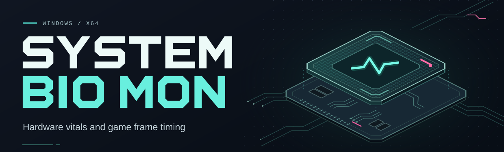
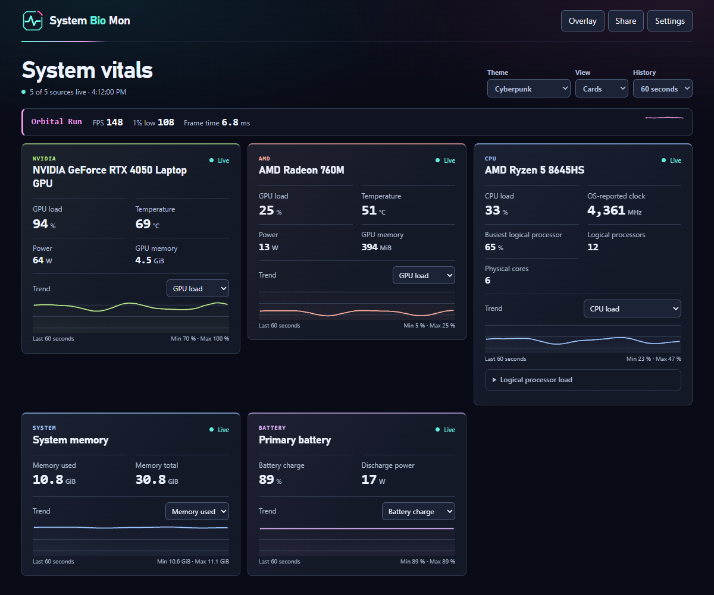
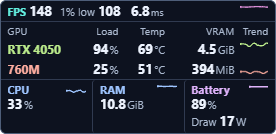
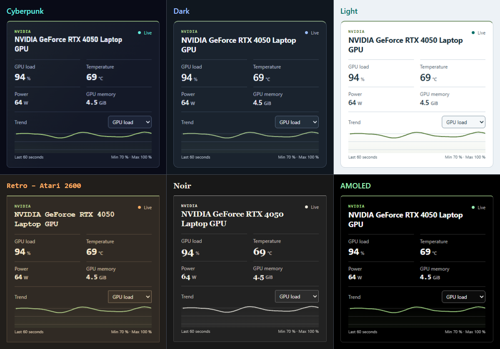

# System Bio Mon

Keep your PC’s vitals in view while you play, render, or run a model. Pin a compact, click-through overlay over your work, open the dashboard to investigate a spike, or scan a QR code to follow the same readings from your phone.

## Install on Windows

Download the x64 build for Windows 10 or 11. [Latest release](https://github.com/MirakSalama/System-Bio-Mon/releases/latest)

| Package | How to run it |
| --- | --- |
| **Installer** | Run `System-Bio-Mon-Setup.exe`, then open **System Bio Mon** from Start. |
| **Portable** | Extract `System-Bio-Mon-Portable.zip` into a folder. Run `System Bio Mon.exe` alongside its `resources` folder. |

Both packages include the sensor reader and frame capture helper. The dashboard uses the Microsoft Edge WebView2 Runtime. If a supported CPU or motherboard sensor is missing, open **Settings → Advanced sensors → Enable advanced sensors**. The optional PawnIO driver installer requests Windows approval. Restart the monitor after setup.

## Read your system



*The dashboard and overlay previews show sample telemetry.*

| Reading | What to look for |
| --- | --- |
| **GPU** | Compare the load, temperature, clocks, power, and VRAM of each supported AMD, NVIDIA, or Intel adapter. Each card exposes the sensors its hardware and driver supply. |
| **CPU** | Check overall load, busiest logical processor, clock speed, and core count. Expand **Logical processor load** to find a busy thread. Supported package sensors add temperature and power. |
| **System** | Track used and total memory separately from CPU load. Battery and motherboard readings appear on machines that expose them. |
| **History and alerts** | Plot a metric over the last minute or five minutes. Set a threshold on one card or on every card that reports the metric. Old samples leave a gap in the graph when a sensor stops reporting. |

### Configure the overlay



Open **Overlay** and turn on **Show always-on-top overlay**. Choose **Horizontal strip** or **Stacked rows**. **Essentials** keeps the readout short. **My selected metrics** uses the readings you enabled in **Settings**.

Pick a corner or unlock the overlay and drag it. Lock it again to pass clicks through to the app underneath. Adjust text size, background opacity, and trend lines there. The dashboard’s **Theme** selector changes the desktop dashboard and overlay together. Choose **Cyberpunk** (the default), **Dark**, **Light**, **Retro – Atari 2600**, **Noir**, or **AMOLED**.

<details>
<summary>Compare all six themes</summary>



</details>

### Read a game’s frame timing

Bring a game to the foreground to start capture. **Only show during games** makes the overlay appear for a detected game and hide when you switch away. Recognition uses game library paths, engine window classes, and the Windows fullscreen 3D signal. Some standalone or unrecognized titles may be missed.

| Metric | Meaning |
| --- | --- |
| **FPS** | The game’s presentation rate, averaged over the most recent second. |
| **1% low** | The FPS equivalent of the mean of the slowest 1% of frame intervals in the last ten seconds. It appears after 100 valid intervals. A drop here can reveal a hitch while average FPS looks steady. |
| **Frame time** | Mean milliseconds between presents over the most recent second. At 60 FPS, a frame takes about 16.7 ms. |

Bundled PresentMon reads Windows graphics events for the detected process. If Windows denies capture, run the app as administrator or use a Windows account with **Performance Log Users** access. The overlay is a separate desktop window. Choose borderless or windowed mode if a game’s exclusive fullscreen mode covers it.

### Follow along on your phone

1. Put the PC and phone on the same trusted local network.
2. Open **Share → Start sharing** on the PC and scan the QR code with the phone. The browser opens a read-only dashboard.
3. Minimize the desktop dashboard to keep monitoring from the system tray. While sharing is active, closing the dashboard also keeps the session running. Use **Open dashboard** in the tray menu to return.
4. Choose **Stop sharing** to revoke the pairing link. A new session creates a fresh link. To exit the monitor and end sharing together, select **Quit System Bio Mon** in the tray menu.

## Build from source

On x64 Windows, install the stable Rust MSVC toolchain, Node.js with npm, Visual Studio Build Tools with **Desktop development with C++** and a Windows SDK, the WebView2 Runtime, and .NET Framework 4.8. The release script uses the 64-bit .NET Framework C# compiler for the sensor helper.

From PowerShell at the repository root, run

```powershell
.\build-release.ps1
```

The script installs the locked Tauri CLI dependencies, builds the helper and Rust desktop app, and creates the installer and portable ZIP in `release\System Bio Mon\`. The first build needs internet access to fetch build dependencies.

The [Rust desktop app](app/src-tauri/src) owns telemetry, game capture, overlay visibility, and local sharing. The [desktop and phone interface](ui) uses HTML, CSS, and JavaScript. The [C# sensor reader](app/sensors) wraps the bundled LibreHardwareMonitor library.

## License and acknowledgments

System Bio Mon’s original code is available under the [MIT license](LICENSE).

The distribution includes LibreHardwareMonitor and its dependencies, AMD ADLX bindings, and Intel PresentMon. Their license texts and upstream source information ship with the app. [Sensor sources and licenses](app/src-tauri/resources/sensors/SOURCES.txt) · [AMD ADLX license](app/src-tauri/resources/AMD-ADLX-LICENSE.txt) · [PresentMon source](app/src-tauri/resources/presentmon/SOURCE.txt) · [PresentMon license](app/src-tauri/resources/presentmon/LICENSE.txt)
